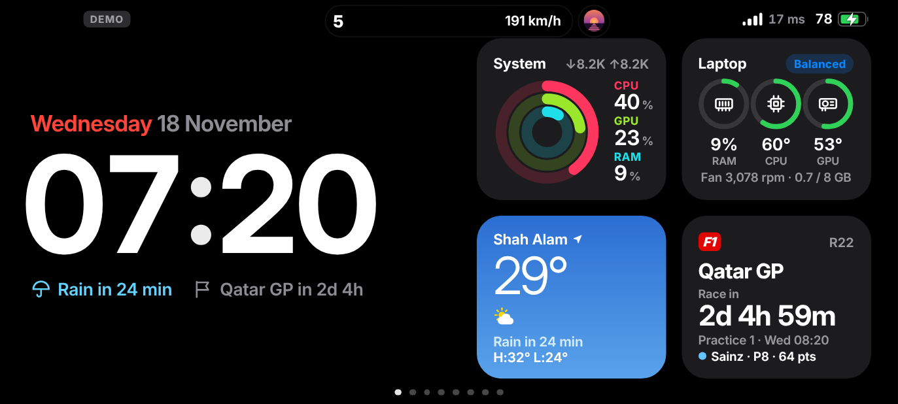
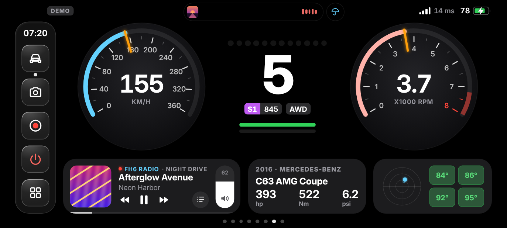
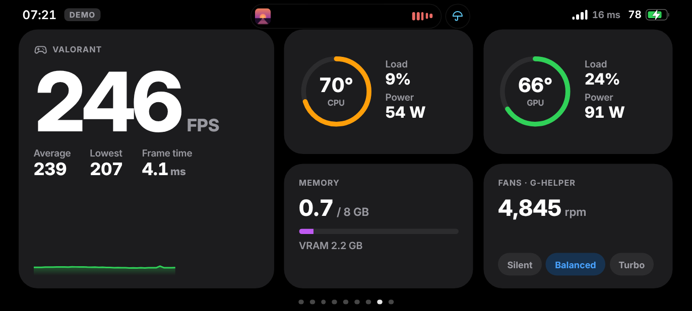
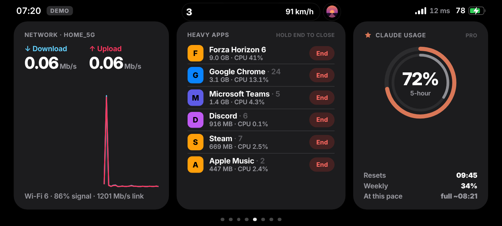
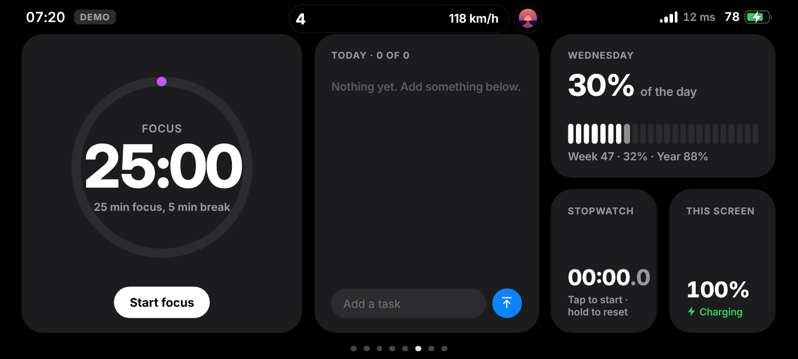
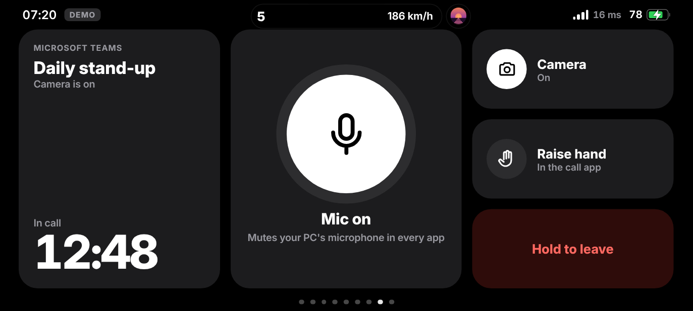
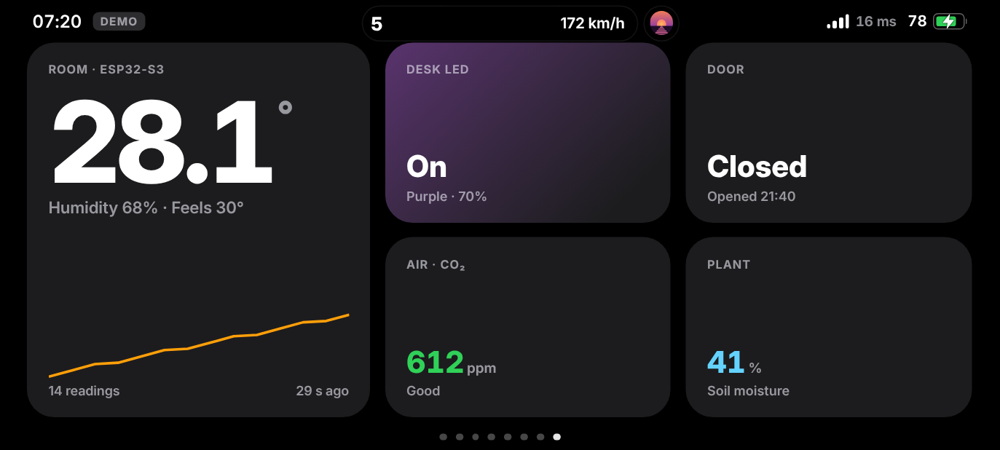
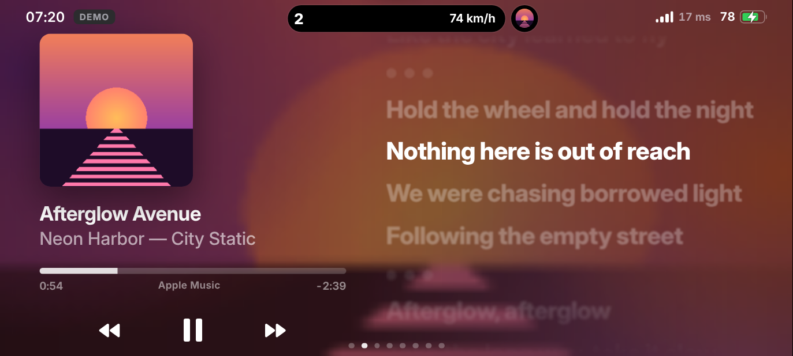
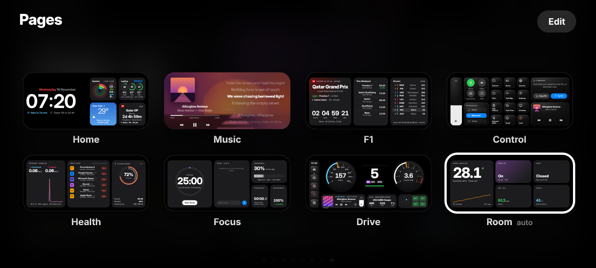

# DeskDeck

Turn a spare phone or an iPad into an Apple-style companion screen for your Windows PC: a StandBy clock, live system stats, Apple Music lyrics, F1, a CarPlay-style Forza Horizon dash, a gaming HUD, meeting controls and your own smart-home tiles. Everything runs on your own network, with no cloud.



| | |
|---|---|
|  |  |
|  |  |
|  |  |
|  |  |

## What's on it

| Page | What it does |
|---|---|
| **Home** | Big StandBy clock (digital / analog / photo frame), CPU/GPU/RAM rings, laptop temps and G-Helper mode, weather with rain alert, F1 countdown |
| **Music** | Apple Music-style synced lyrics, album-colour background, seek and skip. Turns into a full-screen ambient view when idle |
| **F1** | Race weekend sessions in your time zone, countdown and standings, with your favourite driver highlighted |
| **Control** | Volume, mic, screenshot/snip, Silent/Balanced/Turbo, app launchers that switch to the open window, macros, clipboard sync |
| **Health** | Live network graph and Wi-Fi details, the heaviest apps with a hold-to-End button, and your Claude usage (5-hour and weekly) |
| **Focus** | Pomodoro timer and daily checklist shared by every screen, day/week/year progress, stopwatch, screen battery |
| **Drive** | Forza Horizon 6 telemetry as a CarPlay-style cluster: speed, RPM, gear, shift lights, tyres, G-meter. The car name comes up automatically, and FH6 Universal Radio controls include an Up Next queue |
| **Gaming** *(auto)* | Opens by itself when a game is in front: FPS, frame time graph, CPU/GPU temps and power, VRAM, fans, performance mode |
| **Meeting** *(auto)* | Opens when Teams, Zoom, Discord or Meet uses the mic: a big mute button, call timer, camera, raise hand and hold-to-leave |
| **Room** *(auto)* | Tiles and graphs for anything you send to the webhook, such as an ESP32 sensor or Home Assistant |

The top bar works like iOS. The Dynamic Island shows music, On Air (mic/camera in use), rain, F1 sessions, the game's FPS, the focus timer and your PC's notifications.

Tap the page dots to see every page. Tap **Edit** there to choose which pages each screen shows: **Always**, **Auto** (only while it's happening) or **Hidden**. Each device keeps its own choice.

## Install

1. Install **Python 3.11+** from python.org (tick *Add python.exe to PATH*).
2. Double-click **`install.bat`**, then **`start.bat`**, or run `tray.pyw` to keep it in the system tray.
3. Want to look around first? Run `python agent.py --demo` (add `--demo-forza` or `--demo-game` for those pages).

## Connect a screen

**Android phone over USB (recommended)**
1. On the phone, open *Developer options* and turn on **USB debugging** and **Stay awake**.
2. Install Android **platform-tools** so that `adb` works in a terminal.
3. Plug the phone in. DeskDeck runs `adb reverse` by itself. In Chrome, open `http://localhost:8765/?k=YOURTOKEN`, then use *Add to Home screen*.

**iPad or a phone over Wi-Fi**
1. Allow DeskDeck through Windows Firewall on **Private** networks (ports 8765 and 8766).
2. On the iPad, open the **setup link** (tray → *Copy iPad setup link*). Then:
   - Install the DeskDeck profile.
   - Trust it in *Settings → General → About → Certificate Trust Settings*.
   - Open the secure link and choose *Add to Home Screen*.

   HTTPS keeps the screen awake and makes clipboard sync work.

## Optional extras

| Feature | What to do |
|---|---|
| Temperatures, fans, power | Run **LibreHardwareMonitor** with *Remote Web Server* on (port 8085) |
| Performance modes | **G-Helper**: DeskDeck reads its config and switches with Ctrl+Shift+Alt+F16/F17/F18 |
| FPS on the Gaming page | Run **RivaTuner Statistics Server** (comes with MSI Afterburner) |
| Forza Horizon 6 | In FH6, set *Data Out* to `127.0.0.1:5301`. DeskDeck relays the packets to `forza.forward` (default 5300), so haptics apps keep working |
| FH6 radio | Run [FH6 Universal Radio](https://github.com/g0ldyy/fh6-universal-radio). DeskDeck finds it on port 8420 or 8421 |
| Claude usage | Sign in to Claude Code on the same PC. DeskDeck reads the usage behind `/usage`, read-only and at most every 3 minutes |
| PC notifications | Windows *Settings → Privacy & security → Notifications* → let apps access notifications |
| Photo frame | Put JPG/PNG files in `Pictures\DeskDeck` |

## Webhooks (ESP32, Home Assistant, scripts)

Each `key` is the `hook_key` from `config.json`, which is created on first run.

```http
POST http://PC-IP:8765/hook/value?key=KEY
{"id": "room", "label": "Room", "value": 27.4, "unit": "°", "sub": "Humidity 68%", "color": "orange", "ttl": 600}
```

- Several at once: `{"values": [ ... ]}`.
- Plain GET works too: `/hook/value?key=KEY&id=room&value=27.4&unit=°`.
- `true`/`false`/`on`/`off` show as switches. Add `hook_actions` in `config.json` to make a switch call your device when tapped.
- `/hook/notify?key=KEY&app=Door&title=Front door&body=Opened` shows a message on the Dynamic Island.
- `/hook/page?key=KEY&page=room` switches every screen to that page.
- `/hook/clear?key=KEY` (optionally `&id=room`) removes values.

Arduino / ESP32 example:

```cpp
HTTPClient http;
http.begin("http://192.168.1.23:8765/hook/value?key=KEY");
http.addHeader("Content-Type", "application/json");
http.POST("{\"id\":\"room\",\"label\":\"Room\",\"value\":" + String(temp, 1) + ",\"unit\":\"°\"}");
http.end();
```

## Siri Shortcuts

In the Shortcuts app, add **Get Contents of URL**:
`http://PC-IP:8765/api/do?key=KEY&do=lock`

Actions:
- `lock`, `desktop`, `screenshot`, `snip`, `taskview`
- `mic`, `mute`, `vol&v=30`
- `play`, `pause`, `next`, `prev`
- `silent`, `balanced`, `turbo`
- `focus`, `unfocus`, `forza`
- `app&v=discord`, `macro&v=emoji`, `page&v=gaming`

## `config.json`

Restart DeskDeck after editing.

| Key | What it does |
|---|---|
| `location` | Name, lat and lon for the weather |
| `f1_favourite` | Driver id, e.g. `sainz` |
| `apps` | 6 launcher tiles. `cmd` is anything `start` accepts |
| `macros` | 4 tiles: `keys`, `text` or `run` |
| `rules` | Your own auto-pages, e.g. `[{"app": "obs64.exe", "page": "cc"}]` |
| `games` | Extra `.exe` names to treat as games |
| `focus` | Pomodoro minutes: `work`, `short`, `long`, `rounds` |
| `notify` | `enabled`, plus a `block` list of app names |
| `hook_key`, `hook_actions` | Webhooks and Shortcuts |
| `https_port` | Defaults to 8766; set 0 to turn it off |
| `update_repo`, `auto_update` | GitHub `owner/repo` to update from (tray → *Check for updates*) |
| `forza`, `radio_url`, `car_list_url` | Forza listen/forward ports, Universal Radio, car-name list |
| `token` | The secret in the screen link. Delete it to make a new one |

## Credits

- [Inter](https://rsms.me/inter/) font (SIL OFL)
- Weather from [Open-Meteo](https://open-meteo.com/), F1 data from [Jolpica](https://github.com/jolpica/jolpica-f1), lyrics from [LRCLIB](https://lrclib.net/)
- FH6 car names from the community ordinal list used by [LapScope](https://github.com/darcane/LapScope)
- Ideas borrowed from [PhoneBox](https://github.com/ersinkoc/phonebox)
- Works with [LibreHardwareMonitor](https://github.com/LibreHardwareMonitor/LibreHardwareMonitor), [G-Helper](https://github.com/seerge/g-helper), RivaTuner and [FH6 Universal Radio](https://github.com/g0ldyy/fh6-universal-radio)

DeskDeck isn't affiliated with Apple, Microsoft, Playground Games, Formula 1 or Anthropic.

MIT licensed. See [LICENSE](LICENSE).
